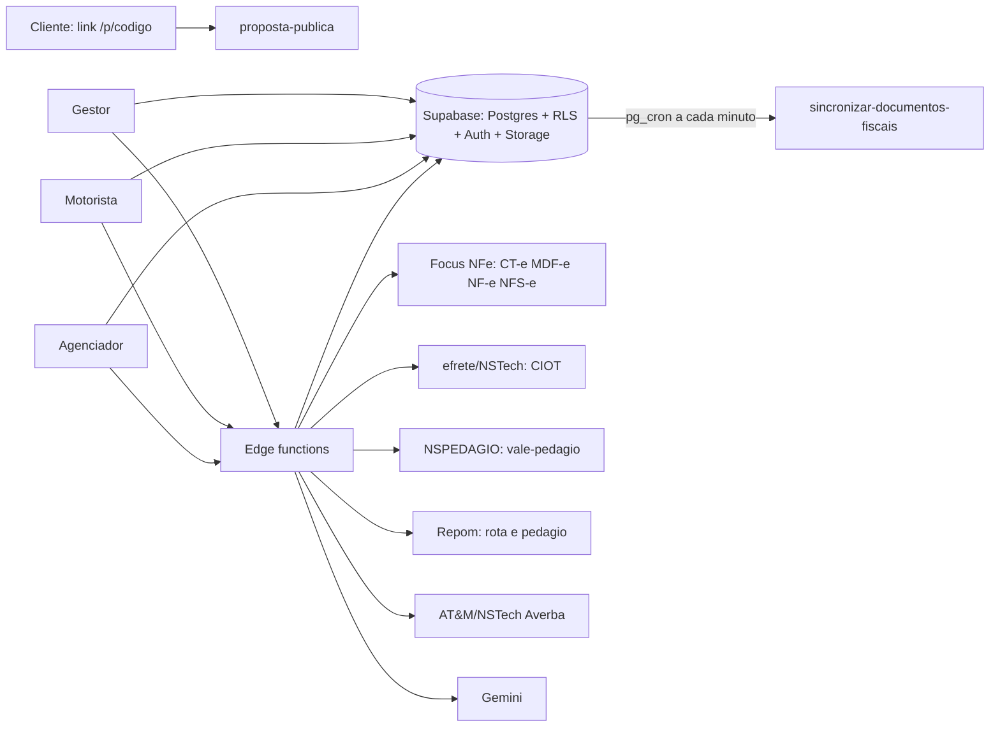

# 01 · Arquitetura

## Fluxo de dados

Evidência: `supabase/functions/*/index.ts` (tabelas e fornecedores por função em [INVENTARIO-FUNCOES](INVENTARIO-FUNCOES.md)). O sync roda por pg_cron a cada minuto (cron.job, ver INVENTARIO-BANCO); a função usa `x-sync-secret` validado por `validar_sync_secret`, "quem chama é o banco").

## Estrutura do repositório
`gestor/`, `motorista/`, `agenciador/` (apps Vite), `shared/` (código comum, alias `@rbr/shared`), `supabase/functions/` (edge functions + `_shared/`), `supabase/migrations/` e `supabase-migrations/` (**duas pastas de migração**, ver INVENTARIO-BANCO), `supabase/rollback/`, `supabase/tests/`, `scripts/deploy-functions.js`, `vercel/efrete-proxy`, `docs/`.

## Deploy
- **Front**: Vercel por pasta de app; `gestor/vercel.json` reescreve tudo para `/index.html` e usa `ignoreCommand` (só rebuilda se mudar `gestor/` ou `shared/`). Integração com GitHub para publicar sozinho (`COMO-PUBLICAR.md`).
- **Funções**: `node scripts/deploy-functions.js <nome>` roda `supabase functions deploy <nome> --project-ref kwscmegsfbtvlnyxougt`. Não imprime segredos.
- **Banco**: migrações aplicadas à mão no projeto (ver divergência em INVENTARIO-BANCO). Regra do time: SQL aditivo com rollback em `supabase/rollback/`.
- Rollback: ver [07-OPERACAO-DO-SISTEMA](07-OPERACAO-DO-SISTEMA.md) (PR 2).

## Flags VITE_* (valores não são segredo; padrão = desligada quando ausente)

| Flag | O que liga | Padrão | Onde |
|---|---|---|---|
| VITE_SUPABASE_URL / VITE_SUPABASE_PUBLISHABLE_KEY | Conexão do front ao Supabase (chave pública, não é segredo de servidor) | obrigatória | `shared/supabaseClient` |
| VITE_REPOM_ROTEIRIZACAO_HABILITADO | Roteirização de pedágio Repom na cotação | desligada | `gestor/src/vite-env.d.ts` |
| VITE_EFRETE_CIOT_HABILITADO | CIOT pela efrete no gestor | desligada | `gestor/src/lib/efreteFlags.ts` |
| VITE_NSPEDAGIO_HABILITADO | Vale-pedágio NSPEDAGIO (homologação) | desligada | `gestor/src/lib/efreteFlags.ts` |
| VITE_DEMO_CIOT | Rota `/demo-ciot` sem login, dados fictícios | desligada; só em preview | `gestor/src/App.tsx` |
| VITE_DEMO_AGENCIADOR | Demonstração do agenciador sem login | desligada; só em preview | `agenciador/src/App.tsx` |
| VITE_AGENCIADOR_MODULOS_RBR | Módulos RBR dentro do agenciador | desligada | `agenciador/src/lib/flags.ts` |
