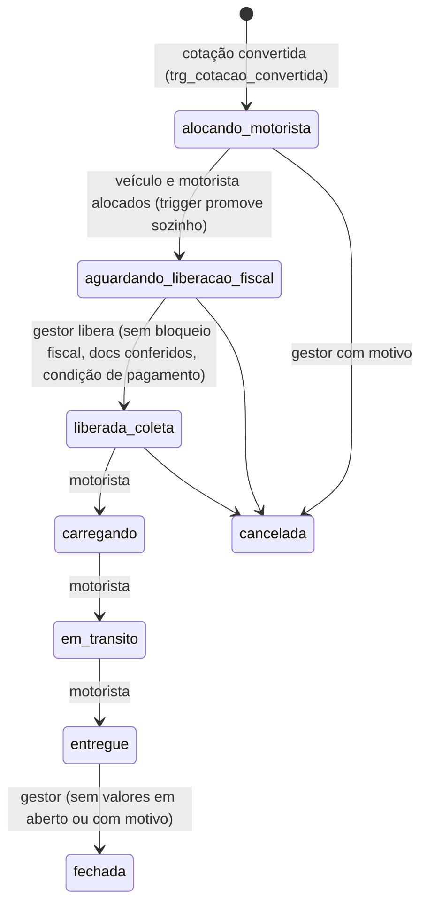

# 03 · Esteira da operação

Fonte: `trg_fn_operacao_valida_transicao` (definição lida no banco em 2026-11-12), enum `status_operacao`, comentário da tabela `operacoes`, `docs/` e `gestor/src/lib/etapasOperacao.ts`.

## Estados (enum `status_operacao`)
Núcleo: `alocando_motorista` → `aguardando_liberacao_fiscal` → `liberada_coleta` → `carregando` → `em_transito` → `entregue` → `fechada` (ou `cancelada`).
Outros valores existentes: aguardando_assumir, aguardando_aceite_motorista, em_emissao, devolvida_pelo_fiscal, pausada_por_alteracao, aguardando_liberacao_gestor, ordem_liberada, em_viagem, finalizando, finalizada. **A confirmar** quais caminham no fluxo atual: a função de transição só valida as regras abaixo; não há tabela de transições permitidas entre todos os estados.

## O que dispara cada transição
| Transição | Quem/o quê | Regra no banco |
|---|---|---|
| criação | `trg_cotacao_convertida` ao converter cotação (aceite/gestor) | cria operação; margem validada por `trg_cotacao_valida_margem` (26%–40% em `parametros_sistema`) |
| → aguardando_liberacao_fiscal | trigger, ao ter `veiculo_id` e `pessoa_alocada_id` | automática no UPDATE |
| → liberada_coleta | gestor/backend (tela Operações, RPC `liberar_operacao_com_ressalva`) | exige: `bloqueio_fiscal=false`; veículo e motorista; **sem** documentos exigidos não conferidos; condição de pagamento do motorista. Com ressalva: motivo + auditoria em `auditoria_log`; **nunca** com documento exigido inexistente |
| → carregando / em_transito / entregue | motorista (app) ou gestor | motorista só nessa sequência; carregando grava `coleta_em`, entregue grava `entregue_em`; exige `liberada_em` |
| → fechada | gestor | só a partir de `entregue`; se há lançamentos `previsto`/`aberto`, exige `fechamento_motivo`; grava `finalizada_em` |
| → cancelada | gestor (`cancelar_operacao`) | exige motivo; grava quem e quando; cancelar desfaz coleta/entrega registradas |
| finalização | RPCs `iniciar_finalizacao` / `terminar_finalizacao` (status `finalizando`/`finalizada`) | a confirmar detalhe |

## Travas fiscais e bloqueios (verificado)
- `bloqueio_fiscal` com motivo impede liberar (exceção levantada pela trigger).
- Documentos exigidos vêm de `documentacao_operacao.exigido`; conferência por IA (`conferir-documento-operacao`) e manual (`aceite_manual_motivo`).
- `trg_exigir_aceite_na_alocacao` (termo do motorista), `trg_trava_suspenso_alocacao`, `trg_trava_conformidade_operacao`, `trg_trava_contrato_operacao`, `trg_operacao_exige_aprovados` (cadastro aprovado).
- `checar_pre_voo`, `checar_alocacao`, `checar_piso_operacao` (piso ANTT) são consultados pela tela antes de avançar.
- `congelada_em` e `pausada_por_alteracao`: operação congelada por alteração após aceite (a confirmar o gatilho).
- Disjuntor fiscal pausa emissão se achado grave (ver 02).
